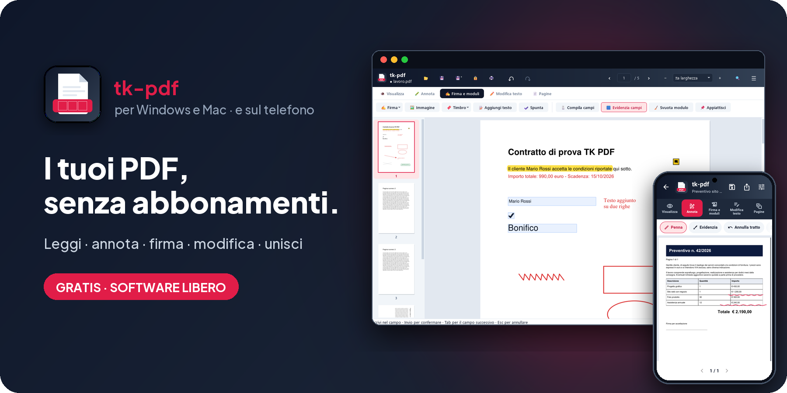
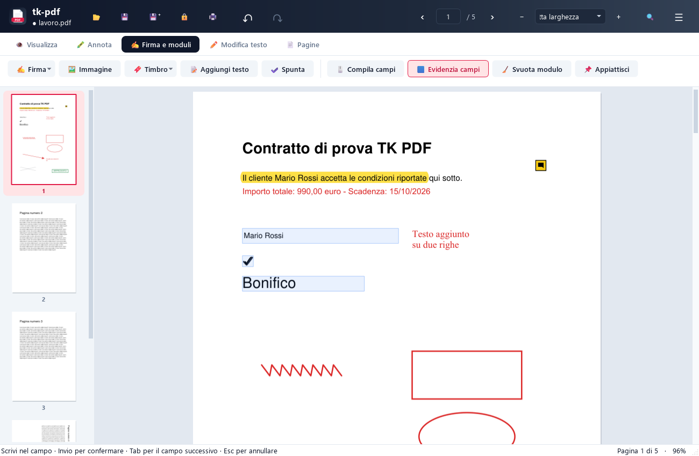

<!-- README generato da Dropbox/CLAUDE/dev/agpl-rollout/readme/genera_readme.py: modificare lì -->
<div align="center">



<br><br>

<a href="https://pietrodefilippis.it/scarica-programma/tk-pdf/windows/"></a> &nbsp; <a href="https://pietrodefilippis.it/scarica-programma/tk-pdf/mac/"></a> &nbsp; <a href="https://pietrodefilippis.it/donazione/"></a>

<br><br>

<a href="COPYING"></a>    

<br>

### Leggi, annota, firma e modifica i PDF. Senza abbonamenti.

Un editor PDF completo per Windows, macOS e Linux: tutte le funzioni, gratis, per sempre.

</div>

---

## ✨ Cosa fa

<table>
<tr>
<td width="50%" valign="top">

### 📖&nbsp; Leggi e cerca
Miniature delle pagine, zoom, ricerca nel testo e stampa.

</td>
<td width="50%" valign="top">

### 🖍️&nbsp; Annota
Evidenzia, sottolinea, scrivi note, disegna a mano libera, aggiungi frecce, forme e timbri.

</td>
</tr>
<tr>
<td width="50%" valign="top">

### ✍️&nbsp; Firma e moduli
Compila i moduli, aggiungi una firma grafica disegnata o da immagine, spunte e caselle di testo.

</td>
<td width="50%" valign="top">

### ✏️&nbsp; Modifica il testo
Correggi le parole direttamente nel PDF, sposta righe e oggetti, cancella per davvero con il bianchetto.

</td>
</tr>
<tr>
<td width="50%" valign="top">

### 📑&nbsp; Pagine
Riordina, ruota, elimina, estrai, dividi e unisci più PDF in uno.

</td>
<td width="50%" valign="top">

### 🔐&nbsp; Proteggi e comprimi
Password con cifratura AES-256, compressione in un file nuovo, foto di documenti trasformate in PDF con il testo riconosciuto.

</td>
</tr>
</table>

## 🖥️ Com'è fatto

<div align="center">

</div>

## 📱 Anche sul telefono

**tk-pdf** c'è anche per Android, gratis e libera come questo programma:
[tk-pdf-app](https://github.com/tecnikgeek-repo/tk-pdf-app).

<a href="https://github.com/tecnikgeek-repo/tk-pdf-app"></a>

## 🔒 I tuoi dati

tk-pdf lavora tutto sul tuo computer: i PDF non vengono mai caricati su internet, nemmeno per il riconoscimento del testo (usa quello di Windows o di macOS; su Linux è incluso nel programma).

| Resta sul tuo computer | Va in rete (e perché) |
|---|---|
| I tuoi PDF e le modifiche | Controllo degli aggiornamenti su pietrodefilippis.it |
| Le firme che salvi | Statistiche anonime, solo se le accetti |
| Il riconoscimento del testo (OCR) | Google Fonts, solo se lo consenti, quando riscrivi un testo con un carattere che manca |

Nessuna pubblicità, nessun account da creare. Le statistiche anonime partono **solo se le accetti** al primo avvio
(si cambiano quando vuoi). Gli aggiornamenti sono **firmati digitalmente**: il programma installa solo quelli
pubblicati dall'autore.

## 📥 Installazione

- **Windows 10 / 11** — scarica l'installer `.exe` e avvialo. Non servono i permessi di amministratore.
- **macOS** (Intel o Apple Silicon) — apri il `.dmg` e trascina l'app in *Applicazioni*. Al primo avvio: clic destro sull'app → *Apri*.
- **Linux** (Ubuntu 22.04 o più recente, x86_64) — scarica il file `.AppImage`, rendilo eseguibile (*Proprietà* → *Esegui come programma*) e aprilo: si aggiunge da solo al menu delle applicazioni.

Gli aggiornamenti arrivano da soli: quando esce una versione nuova il programma te lo propone.

<details>
<summary><b>🛠️ Avviarlo dal codice sorgente</b></summary>

<br>

Serve **Python 3.13**.

```bash
python -m venv .venv
.venv\Scripts\python -m pip install "pyside6-essentials==6.11.*" "pymupdf==1.28.*" certifi
.venv\Scripts\python run.py
```

Su macOS: `source .venv/bin/activate`, poi `pip install "pyside6-essentials==6.11.*" "pymupdf==1.28.*" certifi pyobjc-core pyobjc-framework-Vision` e `python run.py`.

Pacchetti: Windows con `installer\build.ps1`, macOS con `mac/build_mac.sh`, Linux con `linux/build_linux.sh` (AppImage, Tesseract incluso).

</details>

## 📜 Licenza

**tk-pdf** è software libero: © 2026 Pietro De Filippis (TecnikGeek), licenza
**[GNU Affero General Public License v3.0](COPYING)** o successiva. Puoi usarlo, studiarlo, modificarlo e
condividerlo; è fornito **così com'è, senza alcuna garanzia**. I testi delle licenze dei componenti inclusi
(PyMuPDF/MuPDF, Qt/PySide6, Python, certifi) sono nella cartella [`licenze/`](licenze/) e nel programma, in *Informazioni → Licenze e codice
sorgente*.

> Il nome **tk-pdf** e il logo non sono coperti dalla licenza (AGPL, sezione 7): una versione modificata deve
> avere un nome e un logo diversi.

---

<div align="center">

**Ti è utile?** Tutte le funzioni sono gratis per tutti. Se vuoi, un caffè aiuta a migliorarlo e a crearne altri.

<a href="https://pietrodefilippis.it/donazione/"></a>

<sub>Creato da <a href="https://pietrodefilippis.it">Pietro De Filippis · TecnikGeek</a> — Webmaster & UX/UI Designer</sub>

</div>
